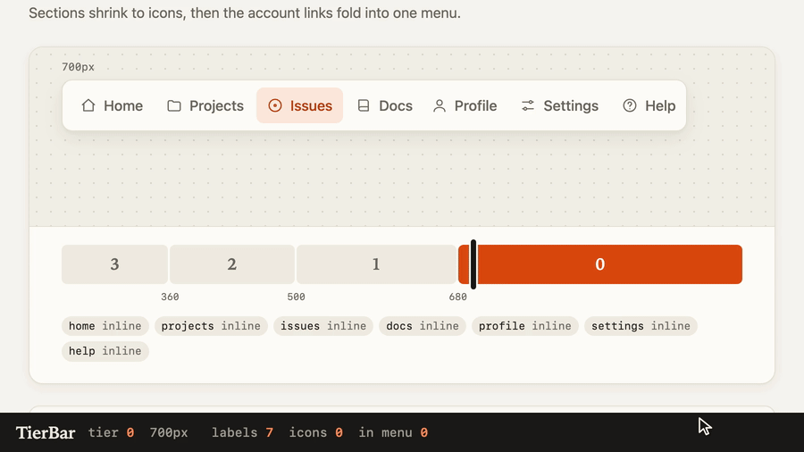
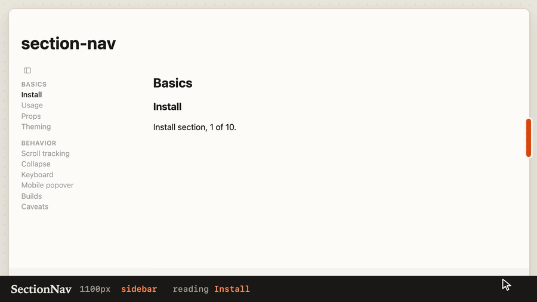

# svelte-bits

Two focused Svelte 5 components for responsive navigation. Pick one at a time: a toolbar that collapses by its own width, or a page navigator that follows your reader.

[](https://github.com/mrgnw/svelte-bits/actions/workflows/ci.yml)
[](LICENSE)
[](https://github.com/mrgnw/svelte-bits/commits/main)
[](https://github.com/mrgnw/svelte-bits/issues)
[](https://svelte.dev)
[](https://github.com/mrgnw/svelte-bits/tree/main/src/lib)

[](https://svelte-components.xces.workers.dev/)

**[Open the live demo](https://svelte-components.xces.workers.dev/)** · [Watch in full resolution (MP4)](docs/media/hero.mp4) · [Install](#install) · [Docs](docs/usage.md) · [Roadmap](ROADMAP.md) · [Contributing](CONTRIBUTING.md)

No runtime dependencies. TypeScript types included. Minimal, overridable styles; TierBar renders your links and buttons through Svelte snippets.

> [!NOTE]
> This project was built with heavy LLM assistance and should be considered proof-of-concept. Contributions are welcome, but I can't guarantee the accuracy of the code or that I will continue to maintain it. If there are any mistakes in attribution or anything else, please let me know.

## Install

This project is not published to npm yet. It is named `@mrgnw/svelte-bits` because the unscoped npm name `svelte-bits` belongs to a different project. Build this repository from GitHub, then add the local package to your Svelte 5 app.

Set the checkout location:

```sh
SVELTE_BITS_REPO=$HOME/src/svelte-bits
```

Run these from your app directory:

```sh
git clone https://github.com/mrgnw/svelte-bits.git "$SVELTE_BITS_REPO"
pnpm --dir "$SVELTE_BITS_REPO" install --frozen-lockfile
pnpm --dir "$SVELTE_BITS_REPO" prepack
pnpm add "@mrgnw/svelte-bits@file:$SVELTE_BITS_REPO"
```

The package exports TierBar from `@mrgnw/svelte-bits` and SectionNav from `@mrgnw/svelte-bits/section-nav`. There is no `@mrgnw/svelte-bits/tierbar` export. The examples below are complete Svelte components.

## TierBar

A navigation or toolbar row that responds to its **container**, so it also works inside a narrow panel on a wide screen. Set descending width breakpoints and choose each item's mode per tier: `inline`, `icon`, or `menu`. CSS container queries select the tier, including in server-rendered HTML.



Full resolution: [tierbar.mp4](docs/media/tierbar.mp4)

```svelte
<script lang="ts">
	import { TierBar, type TierGroup, type TierItem } from '@mrgnw/svelte-bits';

	type Link = TierItem & { label: string; href: string; icon: string };
	const groups: TierGroup<Link>[] = [{
		id: 'main',
		label: 'More pages',
		items: [
			{ id: 'home', label: 'Home', href: '/', icon: '⌂', current: true },
			{ id: 'docs', label: 'Docs', href: '/docs', icon: '▤', at: ['inline', 'icon', 'menu'] }
		]
	}];
</script>

<TierBar as="nav" aria-label="Main" breakpoints={[480, 320]} {groups}>
	{#snippet item(link, mode, variant)}
		<a
			id="nav-{variant}"
			href={link.href}
			aria-label={mode === 'icon' ? link.label : undefined}
			aria-current={link.current ? 'page' : undefined}
		>
			<span aria-hidden="true">{link.icon}</span>
			{#if mode !== 'icon'}{link.label}{/if}
		</a>
	{/snippet}
</TierBar>
```

At 480px and wider, Docs shows its label. Between 320px and 480px it shows its icon. Below 320px it moves into the More pages menu. Home stays inline. Give the bar a parent with a defined available width, such as a block or grid cell.

### TierBar props

| Prop | Type / default | Purpose |
|-|-|-|
| `breakpoints` | Required `readonly number[]` | Positive, finite container widths in px, strictly descending. One more tier than breakpoints. |
| `groups` | Required `readonly TierGroup<T>[]` | Groups of items, in display order. |
| `item` | Required `Snippet<[T, Mode, string]>` | Render an item. Arguments: item, mode, unique `variant` for DOM ids. |
| `trigger` | Optional `Snippet<[TierGroup<T>, boolean]>` | Menu button content; boolean indicates a current item inside. Defaults to the group label. |
| `as` | `'nav'` or `'div'`; default `'div'` | Bar element. |
| HTML attributes | Optional | `class`, `role`, `aria-*`, and other attributes pass to the bar element. |

### TierBar item options

| Field | Type / default | Purpose |
|-|-|-|
| Group `id` | Required `string` | Unique group id within the bar. |
| Group `label` | Required `string` | Accessible name of its menu button. |
| Group `items` | Required `readonly T[]` | Items extending `TierItem`; add fields used by your snippet. |
| Item `id` | Required `string` | Unique item id across the bar. Group and item ids must match `/^[A-Za-z][\w-]*$/`. |
| Item `current` | Optional `boolean` | Adds `data-current` to the wrapper and any menu button holding the item. Your snippet sets `aria-current` or `aria-pressed`. |
| Item `at` | `Mode` or `readonly Mode[]`; default `'inline'` | One mode for all tiers, or widest to narrowest. Last entry repeats. Arrays must be nonempty and no longer than the tier count. |

[Try TierBar](https://svelte-components.xces.workers.dev/) · [Full usage and styling hooks](docs/usage.md) · [How TierBar works](docs/how-it-works.md)

## SectionNav

A sticky page-section sidebar with active-section tracking, a remembered collapse state, and `j` / `k` navigation. Below 64rem it becomes a current-section bar with a popover list. Pass known sections for server-rendered navigation, or omit them to scan headings after mount.



Full resolution: [section-nav.mp4](docs/media/section-nav.mp4)

```svelte
<script lang="ts">
	import SectionNav, { type Section } from '@mrgnw/svelte-bits/section-nav';

	const sections: Section[] = [
		{ id: 'install', title: 'Install' },
		{ id: 'usage', title: 'Usage' }
	];
</script>

<SectionNav {sections} label="On this page" key="guide-sections">
	<section>
		<h2 id="install">Install</h2>
		<p>Build the package and add it to your Svelte 5 app.</p>
	</section>
	<section>
		<h2 id="usage">Usage</h2>
		<p>Import the component you need.</p>
	</section>
</SectionNav>
```

### SectionNav props

| Prop | Type / default | Purpose |
|-|-|-|
| `sections` | Optional `Section[]` | Page-order entries matching content ids. Omit to scan up to 200 headings after mount. |
| `levels` | `string`; default `'h2,h3'` | Selectors to scan when `sections` is absent. With both default levels present, `h2` entries become group headings. |
| `key` | `string`; default `'sidebar'` | localStorage key for the collapsed state. |
| `label` | `string`; default `'Sections'` | Navigation and collapse-button accessible name; initial mobile bar text. |
| `children` | Optional `Snippet` | The page content to wrap. |

### Section options

| Field | Type / default | Purpose |
|-|-|-|
| `id` | Required `string` | Matches an element id in the content. |
| `title` | Required `string` | Visible link text. |
| `group` | Optional `boolean` | Group heading; excluded from active tracking and next/previous shortcuts. |

Use **one SectionNav per page**: it uses the fixed `sections-nav` id. Keep client-side rendering enabled for scroll tracking, keyboard shortcuts, and collapse behavior. Headings must exist when the component mounts; scanning does not observe later content changes.

[Try SectionNav](https://svelte-components.xces.workers.dev/section-nav) · [Theming, behavior, and custom-element build](docs/section-nav/README.md)

## Accessibility and browser support

- TierBar hides inactive variants with `display: none`. Its resize handling moves focus to a visible counterpart when the focused variant disappears. Menus close on Escape, outside clicks, and item activation.
- Your TierBar snippet supplies accessible names for icon-only controls and uses `variant` for unique DOM ids. Render native links or buttons and set their current/pressed state as appropriate.
- SectionNav uses a labelled navigation landmark, links, `aria-current="location"`, and `aria-expanded` on its collapse handle. `b` toggles collapse; `j` and `k` step between sections. Shortcuts are ignored in editable fields, with modifiers held, and while a dialog is open. Collapse transitions respect reduced motion.
- TierBar targets Baseline widely available features, with fallbacks for popovers and anchor positioning. SectionNav requires native Popover API support on mobile; it does **not** share TierBar's popover fallback. See [browser support](docs/browser-support.md) for TierBar's feature and fallback details.
- Automated tests run in Chromium. Cross-browser and assistive-technology coverage is incomplete; see the [open accessibility work](https://github.com/mrgnw/svelte-bits/issues?q=is%3Aissue%20state%3Aopen%20a11y).

## Try the demos locally

From a checkout of this repository:

```sh
pnpm install --frozen-lockfile
pnpm dev
```

- [TierBar navigation and editor toolbar](http://localhost:5262/): resize either demo with its width slider and inspect its live tier readout.
- [SectionNav](http://localhost:5262/section-nav): scroll, follow links, and narrow the browser below 64rem to try the mobile bar.

The README loops and social preview in `docs/media` come from `scripts/record-demos.mjs`, which drives these demo routes with Playwright and encodes with ffmpeg:

```sh
pnpm dev --port 5290
```

```sh
node scripts/record-demos.mjs
```

## Contributing and roadmap

See [CONTRIBUTING.md](CONTRIBUTING.md) for setup, tests, and component conventions. Small fixes and reproducible bug reports are welcome. Browse [good first issues](https://github.com/mrgnw/svelte-bits/issues?q=is%3Aissue%20state%3Aopen%20label%3A%22good%20first%20issue%22) or the [roadmap](ROADMAP.md) before starting a new component.

## License

[MIT](LICENSE)
